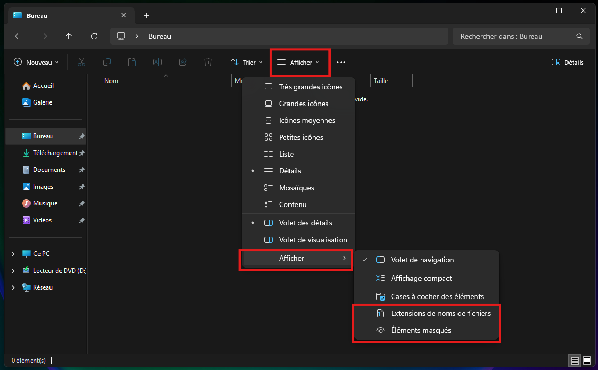
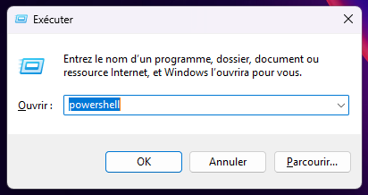
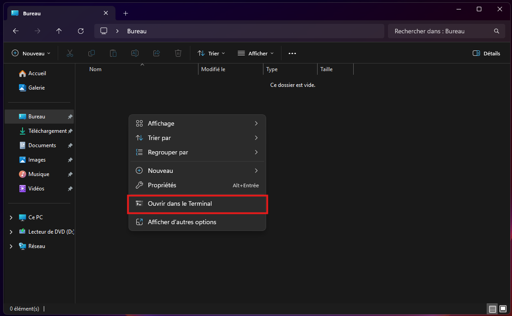
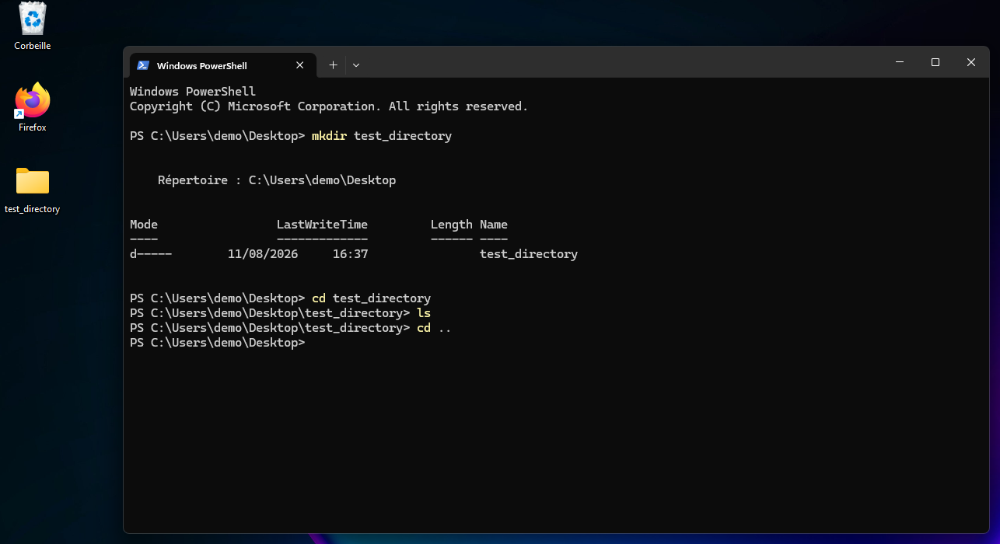
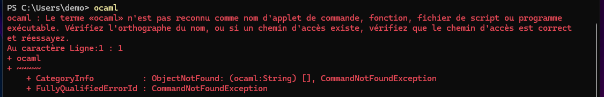
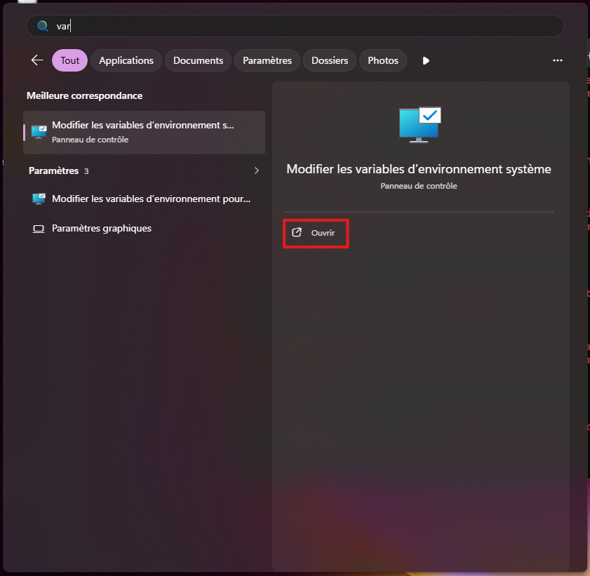
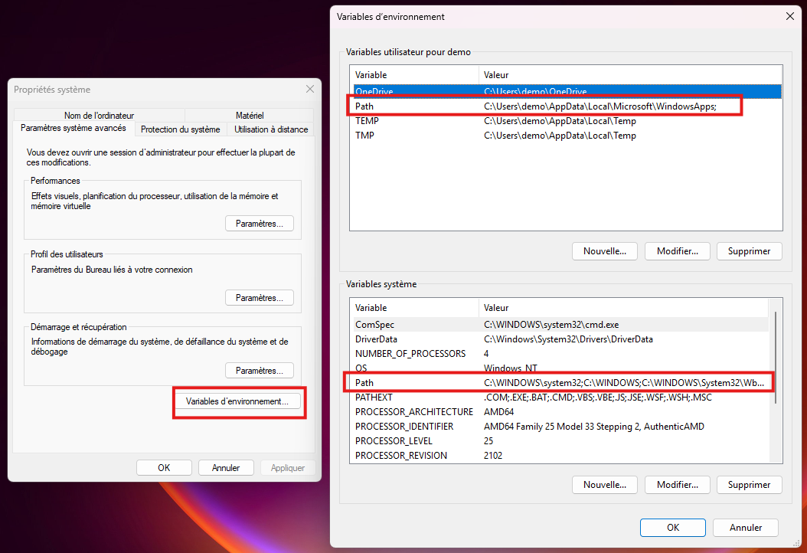

# Introduction

Le système de fichier est un élément essentiel d'un ordinateur, il est chargé d'offrir un modèle qui permet d'accéder, ranger et trier ses données, qui peuvent aussi bien être des images, du texte, ou des programmes (binaires).

Écrire un programme, et plus généralement produire quelque chose avec un ordinateur implique généralement utiliser d'une façon ou d'une autre
le système de fichier. Savoir l'utiliser est une compétence souvent présupposée par beaucoup de ressources. 

Faisons donc un petit point pour être certains de ne rien oublier.

# L'arborescence

Tout système de fichiers expose deux types d'objets :
- **Les fichiers**, qui contiennent les données, le système va essayer de distinguer les fichiers en fonction de ce qu'ils représentent (image, texte, etc.). En pratique, un fichier n'est qu'un tas d'octets et rien d'autre, si un programme décide de créér une image, il ne demande pas au système de créér un fichier image spécifiquement, il ne fait que demander un endroit où écrire quelque chose. 

- **Les dossiers**, qui contient d'autre dossiers et fichiers, les données forment donc un arbre dans lequel les nœuds internes sont les dossiers, et chaque feuille est un fichier.

Pour retrouver un fichier, on lui associe souvent une adresse, qui est la suite des dossiers qu'il faut emprunter pour atteindre le fichier ainsi que le nom du fichier.
Ainsi, une photo de cookie déposée sur mon bureau aura pour adresse: 
```
C:/user/Etienne/desktop/cookie.png
```
Car oui, le bureau est un dossier. Il est parfaitement possible de configurer le système pour utiliser un autre dossier comme bureau.

# Comment interagir avec le système de fichier ?

## 1 / Via explorer.exe

``explorer.exe`` ou plus simplement "l'explorateur de fichiers" est la manière la plus simple et la plus fréquente d'interagir avec le système de fichier. Car son utilisation reste relativement intuitive, je ne vais pas le présenter plus que nécessaire.

Le système de fichier se veut accessible, et cache donc, par défaut, certains détails aux utilisateurs.
- certains dossiers ne sont simplement pas visible.
- les extensions de fichier (par exemple ``.png``) sont cachées par défaut. Ces extensions sont une convention de nommage qui permet d'identifier quel genre de données le fichier contient. Elles sont généralement l'acronyme du format de données utilisé, par exemple ``png`` est l'acronyme de **P**ortable **N**etwork **G**raphics

Il est fortement conseillé de le configurer pour afficher les dossiers cachés ainsi que les extensions des fichiers: 


Il faut cocher ces deux cases.

## 2 / Via un terminal

Il en existe deux sous Windows, ``cmd`` et ``powershell``, ``powershell`` est essentiellement une version modernisée de ``cmd``.
Il y a deux façons d'ouvrir un terminal: 
- A/ via le raccourci ``windows + r`` puis en entrant ``powershell``, ce qui ouvre le terminal dans le dossier utilisateur: 
- B/ en faisant un clic droit dans l'explorateur de fichiers, ce qui ouvre le terminal dans le dossier courant: 

Une fois lancé, le terminal se présente sous la forme suivante
```cmd
PS C:\Users\demo\Desktop>
```
Pour l'utiliser, il suffit d'écrire une commande dedans.
Le terminal dispose d'une commande ``help`` qui explique les autres commandes.
Il est généralement possible d'utiliser ``help`` ou ``--help`` derrière la plupart des commandes dans le terminal pour apprendre leur utilisation.
Le terminal peut effectuer la plupart des opérations fréquentes, cela comprend: 
- ``cd``, qui permet de se déplacer de dossier en dossier, en entrant le chemin relatif (depuis le dossier actif) ou absolu (le chemin entier)
- ``mkdir``, pour "make directory", qui permet de créér un dossier
- ``rmdir``, qui permet de supprimer un dossier
- ``ls``, qui permet d'obtenir une liste des dossiers et fichiers dans le répertoire actif.



J'ai créé un dossier dans le bureau, ce dossier est bien visible depuis le terminal et l'explorateur de fichiers. Je me déplace dedans pour vérifier le contenu du dossier créé, et sans surprise celui-ci est vide. Je retourne dans le bureau en utilisant le chemin relatif ``..`` qui
est un alias pour le chemin du dossier parent.

# Quel est l'intérêt du terminal ?

## Démarrer des programmes:

Le terminal peut aussi démarrer des programmes, la commande suivante, démarre Firefox: 
```
PS C:\Program Files\Mozilla Firefox> ./firefox.exe
```
La syntaxe ``./`` indique qu'il s'agit d'un chemin relatif
Il est tout à fait possible d'utiliser le chemin absolu, par exemple si le terminal est dans un autre répertoire:
```
PS C:\Users\demo> C:/"Program Files"/"Mozilla Firefox"/firefox.exe
```
Le raccourci Firefox présent sur le bureau (l'icône) exécute en fait cette commande, ce qui permet de lancer firefox.

## Passer des arguments:

Certains programmes, lorsqu'on les lance, peuvent prendre des **arguments**. Cette liste d'argument est vide lorsqu'on ouvre un programme depuis l'explorateur de fichiers, on est alors contraint d'utiliser un terminal pour pouvoir les utiliser.

Par exemple, firefox peut prendre [tous ces arguments](https://wiki.mozilla.org/Firefox/CommandLineOptions#Windows).
Ce qui permet par exemple d'ouvrir firefox sur un onglet prédéfini:

```
C:/"Program Files"/"Mozilla Firefox"/firefox.exe -new-tab "https://www.youtube.com/watch?v=dQw4w9WgXcQ&list=RDdQw4w9WgXcQ&start_radio=1"
```
Il suffit de copier la commande dans un terminal, dans n'importe quel répertoire pour voir son effet.

Certains programmes qui n'ont pas d'interface, s'utilisent uniquement de cette manière, c'est le cas de python par exemple!

# C'est quoi le "Path", ou chemin d'accès ?

Il vous arrivera peut être après avoir installé un outil, de rencontrer cette erreur en essayant de l'appeler: 



Le message d'erreur parle de "Verifier si un chemin d'accès existe". Qu'est-ce que cela peut bien être ?

Plus étonnant, si l'on doit spécifier un chemin lorsqu'on démarre un programme, comment des programmes comme python peuvent-ils être lancés ?
Pour rappel python s'utilise de la manière suivante : 
```cmd
python [nom du fichier a démarrer]
```

Lorsqu'on ne spécifie pas de chemin lors de l'appel d'un programme, Windows le cherche dans une liste spéciale, communément appelé "Path".
Si le nom entré est accessible, depuis cette liste, alors le programme est appelé. 

Pour modifier cette liste, cherchez ``variable d'environnement système`` ou simplement ``path`` dans le menu démarrer:


Ce qui va ouvrir la fenêtre de gauche, il suffit de cliquer sur ``variables d'environnement...`` pour obtenir la fenêtre de droite.



Il y a deux variables qui s'appellelent "Path", une est générale, et affetc.e tous les utilisateurs de l'ordinateur,
la seconde n'est que "locale" et affecte l'utilisateur qui fait le changement (l'utilisateur de cet ordinateur s'appellele démo).

Précisément, le path n'est pas une liste des fichiers qui représentent les programmes qui peuvent être appelés n'importe où, mais une liste de
répertoires (de dossiers).

Il est fréquent, lorsqu'on installe un outil de développement, que son installateur propose de "l'ajouter au path". C'est-à-dire d'ajouter le répertoire du logiciel installé pour le rendre disponible partout ("dans n'importe quel terminal").

Il est parfois nécessaire d'aller ajouter soi-même un répertoire dans le Path, par exemple si l'on a refusé que ce soit fait automatiquement lors de l'installation
 d'un outil. Généralement, il n'est pas nécessaire de s'en occuper, mais il est pratique de savoir comment cela fonctionne en cas
de problèmes/erreurs.

# Comment est installé un logiciel sur mon ordinateur ?

Comment Firefox est-il installé sur l'ordinateur, si l'icône sur le bureau n'est qu'une ligne de commande en costard ?
A quoi servent les "autres" dossiers présents sur le disque (dans ``C:/``) si toutes les données utilisateur sont stockées dans ``C:/User`` ?
Comment un logiciel peut-il être installé sur un même ordinateur mais avoir des sauvegardes différentes pour tous les utilisateurs ?

La plupart des logiciels séparent leurs fichiers en deux parties: 
- Les fichiers qui contiennent les binaires de Firefox (le programme en lui-même), qui se trouvent dans ``C:/Program Files/``, ce dossier contient l'intégralité des programmes installés sur l'ordinateur, (si l'installation est correcte). C'est généralement des répertoires enfants de ce dossier qui vont être ajoutés au path !
- Les sauvegardes sont quant à elles beaucoup plus dures à trouver, elles se trouvent dans un dossier caché accessible avec l'alias ``%LOCALAPPDATA%``, qui est résolu vers le chemin ``C:/Users/[Username]/Appdata/Local/``, dossier est donc différent pour chaque utilisateur.

Le dossier ``C:/Windows/`` contient les fichiers interne de Windows, nécessaire au fonctionnement du système, et ne doit généralement pas être modifié.