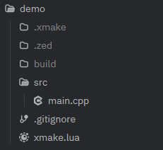
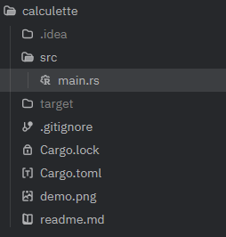

# Introduction

Structurer un projet quelqu'il soit, qu'il s'agisse d'un jeu, une application mobile, de calculs scientifique, n'est pas une mince affaire.
Quels outils utiliser ? Comment éviter qu'il deviennent illisible ? Comment se partager le son contenu, que faut-il inclure et exclure ? Comment
permettre à autruit de le lancer ?

# Un projet, qu'est ce que c'est ?

De façon idépendante du langage, un projet est l'ensemble du **code source**, et des **ressources** ou **assets** (images, vidéos, sons, ect)
utilisés. 
En pratique cela se présente sous la forme d'une arborences de dossiers et fichiers, organisé d'une manière plus ou moins cohérente.

Le plus petit projet possible est composé d'un unique fichier, mais certains projets comme Linux possède plusieurs millions de lignes (27,8
millions) séparés en plusieurs fichiers.

# Comment est transformé le code source en application ?

Avant de pouvoir exécuter (lancer sur l'ordinateur) un projet, un certain nombre de taches doivent être réaliser :
- récuperer les dépendances du projet, c'est-à-dire du code exterieur que notre projet utilise
- transformer le code source en binaires, c'est-à-dire des suites d'instruction logique qui ne sont plus lisible par l'homme, et plus facile a
traiter. (ce processus est généralement appelé **compilation**), généralement plusieurs binaires vont être produit, pour différentes raisons, la
première étant le temps de compilation. Cette tâche étant assez couteuse, séparer en différents unité permet de ne pas tout recommencer au
moindre changement du code source.
- réunir chacun de ces binaires dans un seul executable, qui peut enfin être lancé par le système, cette phase est appelé résolution des symboles
ou **linking** en anglais.

Les langages pour lequels les deux dernières tâches sont réalisés à l'avance, comme le C, C++, Rust, Go sont dit **AOT** (**A**head **O**f
**T**ime). Avoir le binaire final est donc suffisant pour démarrer le programme sur n'importe quel ordinateur.

Une autre approche consiste à réaliser les deux dernières tâches au dernier instant. C'est par exemple l'approche de python. Il est donnecessaire
d'avoir Python d'installé sur son ordinateur pour exectuer un programme en Python. Ces langages sont dit **Interprétés** ou **JIT** (**J**ust
**I**n **T**ime).

Il est tout a fait possible de faire chacune de ses étapes à la main et d'appeler un par un les outils correspondant, mais c'est assez
fastidueux. 

# Automatisation

En pratique on délègue toutes ces tâches à un programme qui va s'en occuper, le **build system**:
On écrit un fichier de configuration qui décrit comment le code source est découpé, quels sont ses dépendances et cet outil se débrouille pour
installer ce qu'il faut, puis effectuer les tâches nécessaires pour obtenir un exectuable. Le second avantage est qu'il sont généralement plus
futé que nous pour réutiliser les résultats des compilations précédentes.

Utiliser ces outils présente un deuxième avantage, ils simplifient considérablement le partage de projet: ils sont en charge d'installer tout le necessaire pour que l'executable soit correctement produit, et évite donc à un autre utilisateur de devoir installer les dépendances un à un.

| Langage | Build system            |
| :------ |:-----------------------:|
| C/C++   |   Xmake/Cmake/Menson    |
| Rust    |     Cargo               |
| Java    |     Gradle/Maven        |
| Python  |     Uv                  |
| Ocaml   |     Dune                |

La plupart de ces outils s'utilisent uniquement dans le Terminal mais sont particulièrement bien documenté et dispose de patrons pour commencer plus facilement.

# Exemples 

## En C++

* le fichier ``xmake.lua`` sert à configurer la construction du projet.
* les sources du programme sont réuni dans un dossier appelé ``src`` (source)
* d'autres outils, qui ne sont pas directement nécessaire à la construction du projet peuvent parfois disposer eux aussi d'un fichier de configuration à la **racine du projet** (le dossier qui contient l'entireté du projet), par exemple ce projet dispose d'un fichier ``.gitignore``, qui permet de configurer ``git`` un logiciel de partage de code source
* certains dossiers vont être crée par les outils de développement, par exemple le dossier ``.xmake``, qui contient des information interne au fonctionnement de xmake, ou ``build``, qui contient l'executable du logiciel. Ces dossiers peuvent être supprimé sans problème car ils ne servent qu'à accelerer différentes tâches. Ils seront donc reconstruit à la prochaine éxecution du code source.
* il est aussi possible de trouver des données "personnelles", comme la configuration de l'éditeur de texte (ici Zed) que l'on utilise sur ce projet. 

## En Rust

* ici ce sont les fichiers ``Cargo.toml`` et ``Cargo.lock`` qui ont la même fonction que le ``xmake.lua`` du projet précédent.
* On retrouve toujours un dossier ``src``, qui contient les sources du programme.
* ici le dossier qui contient les binaires `générés lors de la compilation s'appel ``target`` à la place de ``build`` mais assure la même fonction.