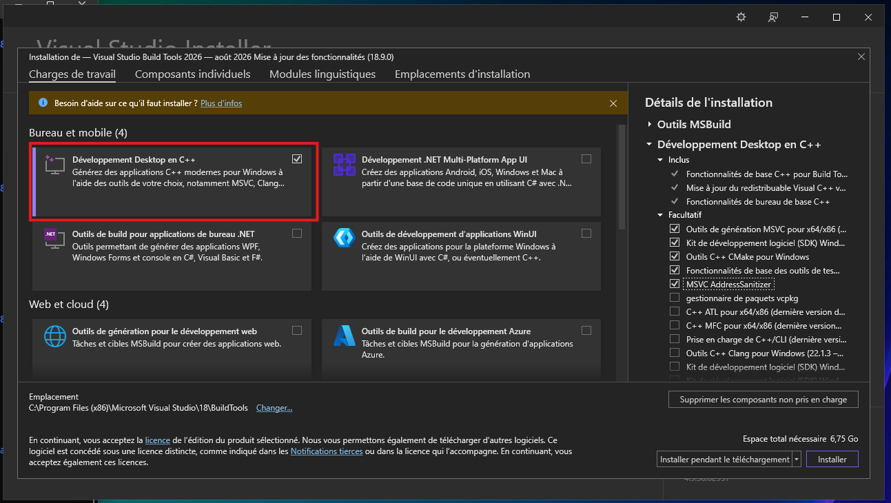

# Introduction

Si certains programment sur du papier, la technologie aide grandement les moldus à programmer: complétition
automatique, erreurs en temps réels, mise en forme automatique. Beaucoup de mots compliqués pour un seul objectif, se simplifier
la vie. Que faut-il alors pour utiliser C++ ?

# Le nécessaire

En réalité, seul un outil est nécessaire pour programmer en C++: le **compilateur** (plus exactement deux, on a souvent besoin de son
petit frère le **linker**).
C'est le programme qui transforme le C++ lisible par l'homme en code machine.
Le linker lui relie les ces bouts de code en un seul programme.
On appel généralement la paire Compilateur + Linker une **toolchain**

Il en existe principalement 3 dans le cas de C++:
* La toolchain **GNU** historiquement la plus vieille, généralement raccourci au nom de son compilateur **GCC**, c'est le compilateur
installé par défaut sur toutes les distributions Linux.
* Celle de Microsoft, qui est utilisé pour la plupart des projets sous Windows.
* Plus récement est apparu une troisième alternative, le projet **LLVM** disponible sur toutes les platformes. Son compilateur
**clang** a été crée comme une alternative a gcc qui devient de plus en plus difficile à maintenir, et se veut compatible avec les deux autres compilateurs. Clang à pris une place dominante dans l'industrie, Google Chrome est compilé avec ce compilateur depuis des années.

Si l'on doit s'occuper d'installer ces outils sur le système, leur on délègue leur utilisation à un **build system**, qui s'occupe de les appeler correctement. Sur un projet important, il est fréquent que la commande de compilation à passer au compilateur fasse plusieurs centaines de caractères !   

# L'utile

Vu qu'écrire du code contient le mot écrire, il est sympatique d'avoir un éditeur de texte sous la main, cet éditeur peut être
quelconque. Certains sorciers utilise directement le terminal.

Il existe de nombreux éditeurs de texte spécifiquement pour le developpement logiciel: Les plus connus sont [Visual Studio Code](https://code.visualstudio.com/), [Vscodium](https://vscodium.com/), [Atom](https://atom-editor.cc/), [Sublime texte](https://wwwsublimetext.com/), [Fleet](https://www.jetbrains.com/fr-fr/fleet/), [Zed](https://zed.dev/)

# L'agréable

Avoir un éditeur de texte c'est bien, mais un éditeur intelligent qui est capable de trouver les erreurs dans le code que l'on est en
train d'écrire c'est mieux. Pour cela d'ingénieux informaticiens ont crée le **L**anguage **S**erver **P**rotocol (LSP). C'est un
protocole standardisé pour qu'un outil d'analyse du code et l'éditeur de texte communique. On peut alors choisir différents serveur
d'analyse du code, qui vont offrir différentes fonctions: propostion, vérifications des types, aller à la définition d'une fonction,
renommer un objet en fonction de son usage ect.

Pour C++, les deux plus connus sont **IntelliSense** de microsoft et **clangd** du projet LLVM.

Un autre outil sympatique est le **Debuger** il permet d'arrêter et d'inspecter les entrailles d'un programme pour trouver les causes
d'un bug.

# Que faut-il installer ?

## Option 1: Les IDE

Un IDE (**I**tegrated **D**eveloppement **E**nvironnement) est un logiciel tout en un, qui va se charger d'installer tout ce qu'il
faut dans son coin. Ils vont généralement installer eux même la toolchain, fournir un build system et un editeur de texte avec des
outils d'analyse de prêt.
* [Visual Studio](https://visualstudio.microsoft.com/fr/) (pas code, merci Microsoft pour ces noms explicite...) est orobablement
l'option la plus directe sous window, et contient bon nombre d'outils, son installation est quasiment incontournable même dans l
choix d'un autre outil. **Il ne faut pas oublier d'installer la charge de travail C++ dans l'installateur**.
* [QtCreator](https://www.qt.io/development/tools/qt-creator-ide)
* [CLion](https://www.jetbrains.com/fr-fr/clion/) outil le plus poussé, mais aussi le plus lourd. Les logiciels jetbrains sont réputer
pour mettre les ordinateurs à genoux.

Pour chaque IDE, il faut compter une dizaine de Go de place prise par l'installation. Visual Studio 2026 avec les outils adapté prend quasiment 13Go !

Si la place n'est pas importante, installer Visual Sudio est probablement l'option la plus simple.
Peu importe l'IDE choisi. Il est (**très**) fortement conseillé d'aussi installer Xmake. (voir ci dessous).


## Option 2: Installer ses outils soit même

Je propose une petit installation que j'utilise personnellement pour faire du C++.
Les outils ont été choisis car ils sont cross platform (Windows, Mac, Linux), et particulièrement légers, ce qui fait souvent défaut aux IDEs.

A titre comparatif, ouvert sur le même projet, Visual Studio utilise environ 650mo de RAM lors que Zed en utilise seulement 300.

Visual Studio utilise 10 fois plus de RAM alors qu'il est le plus léger des trois options: Clion utilise entre 1 et 2 Go de Ram.

### Petite interlude Winget

Winget est un gestionnaire de packet installé par défaut sous window, et permet d'installer automatiquement n'importe quoi:
Son utilisation reste relativement simple, mais voici les commandes basiques: 
On peut chercher le nom exact d'un packet via la commande:
```
winget search [logiciel a chercher]
```
On installe quelque chose via la commande 
```
winget install -i [nom du packet] 
```
le ``-i`` est option, il spécifie que l'on souhaite une installation interactive si possible, ce qui nous permet de parametrer l'installation.

### Installer le compilateur de microsoft

On doit toujours installer Visual Studio, si vous avez installé Visual Studio entièrement pour l'utiliser comme IDE, cette étape est inutile. Pour réduire l'espace utilisé on peut être plus futé, et installer seulement le strict nécessaire via la commande : 
```
winget install -i Microsoft.VisualStudio.BuildTools
```

Cela nous ouvre ce menu suivant, dans lequel il faut selectionner la charge de travail C++ :




### Installer Xmake (build système)

Xmake est le build system que j'utilise personnellement, et le plus simple a utiliser.
Pour l'installer, il faut entrer:
```
winget install -i Xmake-io.Xmake
```
Ce qui va aussi ouvrir un installateur, mais celui-ci est correctement configuré, il suffit d'accepter et de cliquer sur ``suivant``
jusqu'à ce que la procédure se termine.

Arrivé ici, tout le nécessaire pour executer du C++ est installé, il ne reste plus qu'a mettre en place un éditeur de texte.
Il est inutile de faire l'étape si dessous si vous avez choisi d'utiliser Visual Studio comme IDE.

### Installer Zed (éditeur de texte)

Zed est un éditeur de texte complet et léger, il installe un serveur d'analyse automatiquement, et dipose d'extensions pour 
configurer xmake. Pour installer Zed, la commande suivante suffit :
```
winget install -i ZedIndustries.Zed
```

Configurer Zed selons vos préférences, c'est-à-dire probablement les paramètres par défaut.
Deux extensions sont fortement conseillées pour une expérience optimale, mais ne sont pas nécessaire: 
- [L'extension Lua](https://zed.dev/extensions/lua), qui est simplement necessaire pour l'extension si dessous
- [L'extension Xmake](https://zed.dev/extensions/xmake), qui affiche la documentation lors de la configuration de Xmake.

Une fois ces deux extensions installées, tous vos outils sont prêt pour changer le monde.

# Créer son premier projet

Ouvrez un terminal dans le dossier où vous souhaitez créer votre projet, par exemple, je stock tous mes projets de programmations dans un dossier a l'addresse suivante ``C:/Users/[Mon Nom d'utilisateur]/dev``.
Suivez les instructions en fonction de votre choix précédent (Visual Studio ou Zed), et entrez dans ce terminal les commandes suivantes: 

## Avec Visual Studio

```
xmake create mon_premier_projet
cd mon_premier_projet
xmake project -k vsxmake
start devenv vsxmake2026/mon_premier_projet.sln
```

Une fois ces commandes executé, cela devrait ouvrir Visual Studio avec un projet fraichemenent crée.
Un petit explorateur de fichier doit apparaitre sur droite.
Il vous permet d'acceder et d'ouvrir facile les fichiers contenu dans le projet.

Pour démarrer le code, il suffit d'appuyer sur la flèche verte à coté duquel il est inscrit ``Déboggueur Windows local``

## Avec Zed

```
xmake create mon_premier_projet
cd mon_premier_projet
xmake project -k compile_commands
zed ./
```

Une fois ces commandes executé, cela devrait ouvrir Zed avec un projet fraichemenent crée.

Un petit explorateur de fichier doit apparaitre sur la gauche ou la droite (selon la configuration initiale de Zed)
Il vous permet d'acceder et d'ouvrir facile les fichiers contenu dans le projet.

Dans le coin inférieur droit, il y a un icon terminal, qui permet d'ouvrir un terminal.
Entrez dedans
```
xmake run
```
Cela va compiler puis exéctuer le programme contenu dans le dossier ``/src``.

## Que diantre on fait ces commandes ??

Peu importe l'environnement choisi, c'est commandes réalisent la même tâche: 
- Demander a xmake de créer un nouveau projet pour nous
- Se déplacer dans le dossier créé pour ce projet
- Créer les données nécessaires pour que les outils d'analyse fassent correctement leur travail
- ouvrir l'éditeur de texte correspondant. 